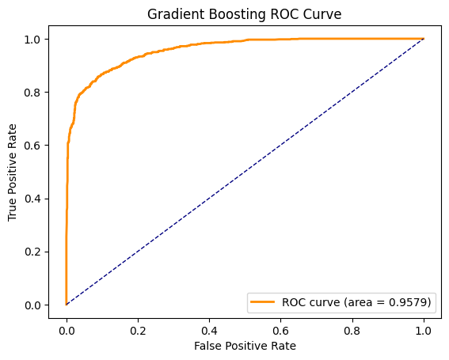
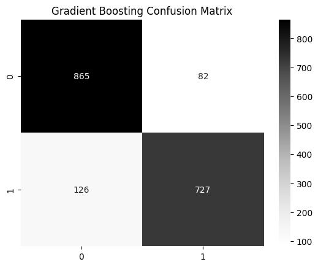

# Binary Classification — Feature Engineering and Model Evaluation

Academic machine learning coursework at the University of Messina (2025). This repository preserves an exploratory classification experiment and its historical outputs. It is not a validated predictive system.

## Dataset

The notebook records 9,000 observations, 8 numerical predictors, 2 categorical predictors and one binary target (4,721 class-0 and 4,279 class-1 observations). There are 400 missing values in feature_3 and 500 in feature_6. The original CSV (`final_project_dataset_complete.csv`) is not included in the supplied repository; its origin and distribution permissions are unknown. Feature and target semantics are unspecified.

## Methodology

- Exploratory analysis: distributions, correlations, chi-square feature scores and Welch's t-tests.
- Median imputation, IQR clipping, categorical encoding and standardization.
- Nine candidate engineered features: products, sums, squared term and row-wise aggregates. Four engineered features retained; final design matrix contains nine predictors.
- 80/20 split (7,200 training and 1,800 test observations), five-fold cross-validation and GridSearchCV using accuracy.
- Logistic Regression, Decision Tree, Random Forest, Gradient Boosting and AdaBoost.
- ROC curves, confusion matrices, classification reports and exploratory feature importance/SHAP.

## Historical results — not leakage-safe

| Model | Baseline test AUC | Tuned test AUC | Tuned test accuracy | Baseline CV AUC |
|---|---:|---:|---:|---:|
| Logistic Regression | 0.9372 | 0.9372 | 0.8583 | 0.9363 |
| Decision Tree | 0.8344 | 0.9215 | 0.8622 | 0.8399 |
| Random Forest | 0.9515 | 0.9567 | 0.8817 | 0.9517 |
| Gradient Boosting | 0.9581 | 0.9579 | 0.8844 | 0.9591 |
| AdaBoost | 0.9479 | 0.9484 | 0.8694 | 0.9461 |

Gradient Boosting had the highest tuned accuracy and AUC; tuning slightly reduced its AUC relative to baseline. Decision Tree AUC increased by 0.0871. These are saved outputs, not independently reproduced results.

## Limitations and next steps

**Target leakage:** notebook cell 42 clips numerical features separately by true target class before splitting. This requires unavailable labels at inference and contaminates evaluation. Imputation, encoding and target-informed feature selection also precede final splitting; scaling is fitted before cross-validation. Consequently, neither test nor CV results establish generalization. Split raw data first, remove class-conditioned clipping, fit transformations and supervised selection inside training folds, and reserve an untouched test set. Compare corrected models with the historical results.

The saved Gradient Boosting SHAP analysis passes unscaled data to a model trained on standardized inputs; do not interpret it as reliable attribution. Recompute using the fitted transformation. Some early pickle calls save estimator classes rather than fitted objects. Later calls save fitted estimators but omit preprocessing. Save a complete fitted pipeline instead.

## Inspect the experiment

Open [classification_archived.ipynb](classification_archived.ipynb) to see historical code and outputs. Local personal download paths were replaced with relative paths or a display placeholder. No training was rerun. The archive is not a corrected modeling pipeline.

To explore locally, create a Python 3.11 environment and install `requirements.txt`. Open the notebook with Jupyter. Full reproduction requires the original CSV and correction of the issues above. The dependency list is a best-effort environment specification, not a tested lockfile.

## Files

- `classification_archived.ipynb`: historical experiment
- `figures/`: original saved figures (SHAP historical plot retained for audit only)
- `requirements.txt`: dependencies

